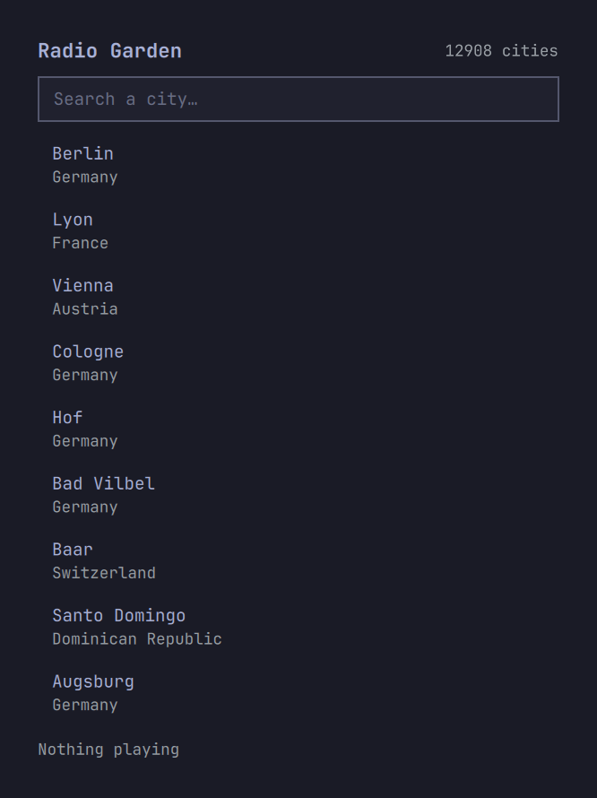
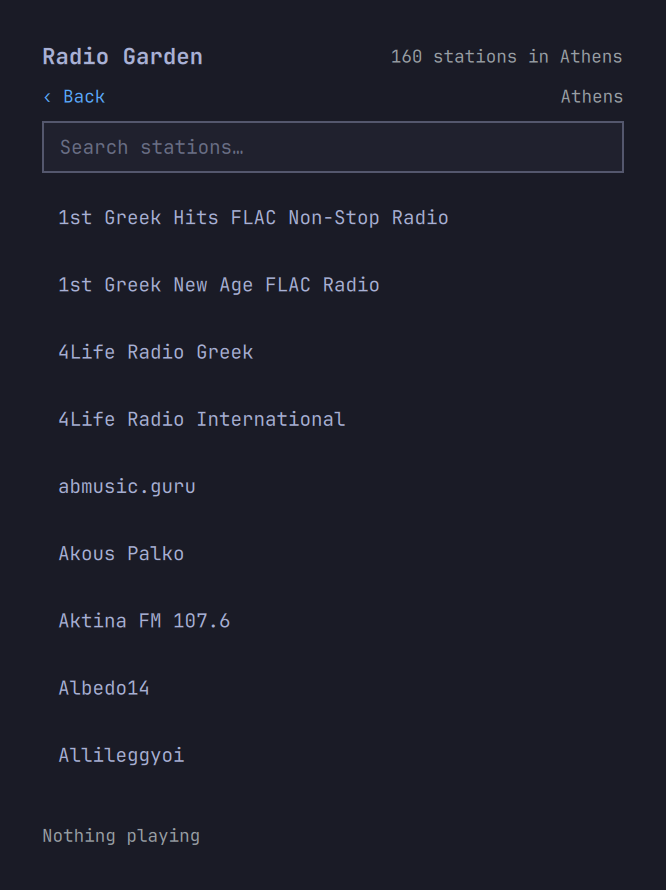

# Radio Garden for Omarchy

A bar widget that browses live radio stations by city — powered by
[Radio Garden](https://radio.garden) — and plays them from the Omarchy bar.

Click the radio icon in the bar, search for a city, open it, and pick a
station. Streams play in the background with `mpv`; the icon highlights while
something is playing.





## Install

```sh
omarchy plugin add https://github.com/pkouts/omarchy-radio-garden.git --enable
```

Then place the widget on the bar:

```sh
omarchy bar move pkouts.radio-garden --section centerEnd
```

## Requirements

- **`mpv`** — audio playback. Install it from the Arch repositories (package `mpv`).
- **`curl`** — fetches the station list for a city (already present on Arch).
- **Network access** to `radio.garden` when opening a city.

The full list of 12,000+ cities ships with the plugin (`modules.json`), so
browsing cities works offline; only loading a city's stations needs the network.

## Usage

- **Left / right click** the bar icon: open or close the panel.
- **Middle click**: stop playback.
- In the panel: type to filter cities → click a city → type to filter that
  city's stations → click a station to play. The footer shows the current
  station with **play/pause** and **Stop** controls.
- While playing, the bar icon is highlighted and its tooltip shows the station.
- State is shared: with the bar on several monitors, every instance shows the
  same city, station list, search text and playback state, and only one player
  runs. Pausing keeps the station ready to resume.

## Configure

The widget lives in `bar.layout`; move it like any other bar widget:

```sh
omarchy bar move pkouts.radio-garden --section center
```

## Remove

```sh
omarchy plugin remove pkouts.radio-garden
```

## Notes

- Radio Garden's public API is behind a CDN challenge; the plugin sends a
  normal browser User-Agent so the API responds. No account or key is needed.
- Playback shells out to `mpv` with an argument list (no shell interpolation).
- Station data comes from Radio Garden and is not bundled beyond the city list.

## License

MIT — see [LICENSE](LICENSE).
